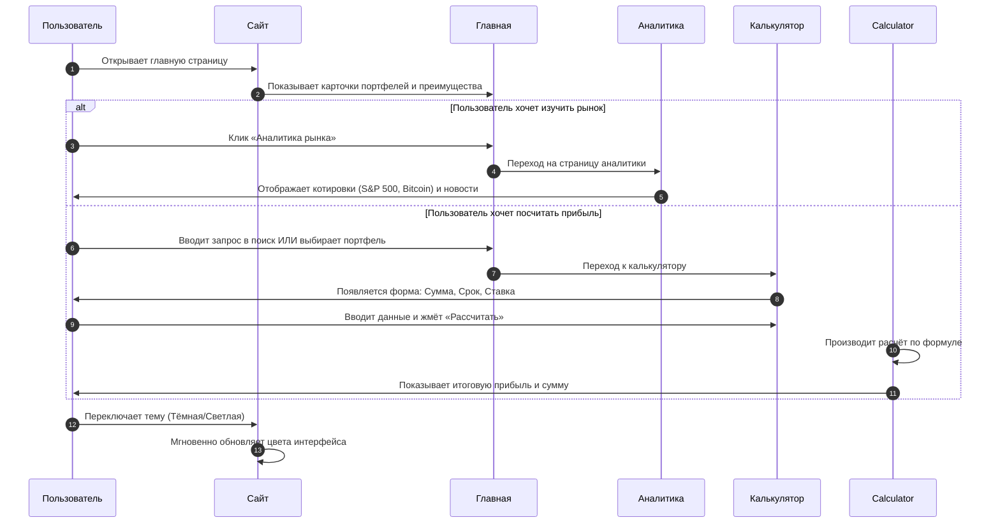

# 📊 UPtrend — Аналитика, Инвестиции, Будущее

> **UPtrend** — финансовый аналитический портал для тех, кто хочет разобраться в мире инвестиций. Сайт помогает новичкам понять основы инвестирования, а продвинутым пользователям — отслеживать рыночные тренды и рассчитывать потенциальную доходность. Проект состоит из трёх взаимосвязанных страниц: Главная, Аналитика и Калькулятор рисков.


---
## 🚀 Что умеет проект

Мы реализовали полный набор инструментов для финансового планирования:

### 💼 Для инвестора
- **Витрина инвестиционных портфелей**: 6 готовых стратегий (от консервативных до агрессивных) с указанием риска, доходности и минимальной суммы входа.
- **Калькулятор доходности**: расчёт итоговой суммы и прибыли по формуле сложных процентов. Поля ввода адаптированы под мобильные устройства.
- **Поиск и фильтрация**: мгновенный поиск по названию актива и фильтрация портфелей по уровню риска (Низкий / Средний / Высокий).

### 📊 Для аналитика
- **Блок рыночных котировок**: отображение актуальных цен на S&P 500, Bitcoin, Золото и Нефть с индикатором роста/падения.
- **Лента новостей**: секция с последними финансовыми событиями (ФРС, недвижимость, энергетика).
- **Динамика рынка**: текстовый отчёт о трендах за последние 30 дней.


## 🚀 Функционал проекта

Мы реализовали набор функций, актуальный для финансовых сервисов:

- 📱 **Адаптивный дизайн** — корректное отображение на мобильных устройствах, планшетах и десктопах. Использованы Flexbox и Grid-системы.
- 🎨 **Тёмная и светлая тема** — пользователь может переключать тему интерфейса одним кликом. Реализовано через CSS-переменные и JS-логику с сохранением выбора в `localStorage`.
- 🗺️ **Навигация между страницами** — интуитивное меню и быстрые ссылки на ключевые разделы (Главная, Аналитика, Инвестиции).
- ✨ **JS-эффекты** — плавная прокрутка, анимация появления карточек при скролле (fade-in), интерактивные тултипы с пояснениями финансовых терминов.

---

## 🧠 Как работает проект: схема взаимодействия

**Ниже показана логика работы сайта: какие действия совершает пользователь и как система на них реагирует.**


## 🌐 GitHub Pages

Сайт уже опубликован и доступен по адресу:
👉https://robertfreemen.github.io/Teamcomade_site/

---

## 📁 Структура проекта

```text
Teamcomadesite/
├── 📄 index.html                 # Главная страница
├── 📄 Analytic.html              # Страница "Аналитика"
├── 📄 Investate.html             # Страница "Инвестиции"
├──
├── 📄 script.js                  # JavaScript
│
│
├── 📁 css/                       # Стили
│   ├── 📄 style.css              # Основные стили
│
│
├── 📄 README.md                  # Этот файл

