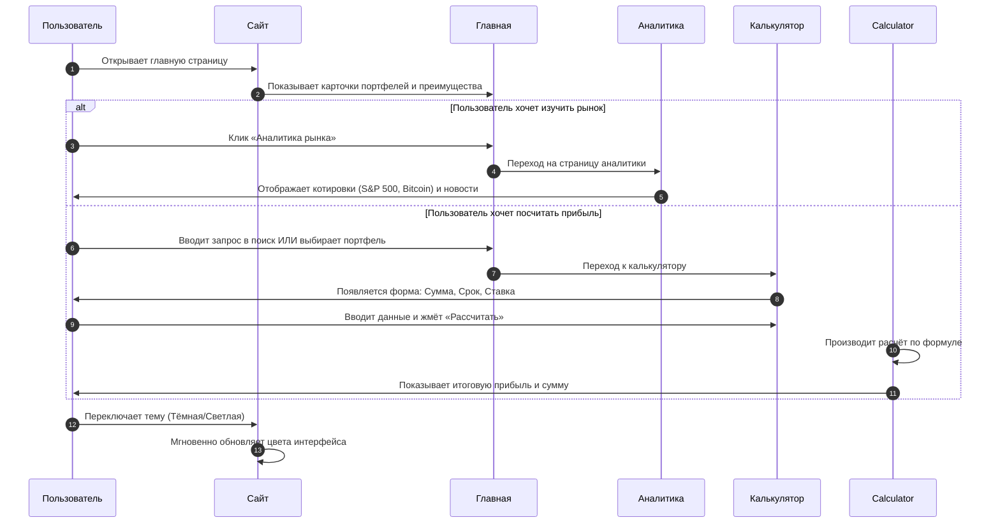

# 📊 UPtrend — Аналитика, Инвестиции, Будущее

> **UPtrend** — финансовый аналитический портал для тех, кто хочет разобраться в мире инвестиций. Сайт помогает новичкам понять основы инвестирования, а продвинутым пользователям — отслеживать рыночные тренды и рассчитывать потенциальную доходность. Проект состоит из трёх взаимосвязанных страниц: Главная, Аналитика и Калькулятор рисков.

---

## 🚀 Функционал проекта

Мы реализовали набор функций, актуальный для финансовых сервисов:

- 📱 **Адаптивный дизайн** — корректное отображение на мобильных устройствах, планшетах и десктопах. Использованы Flexbox и Grid-системы.
- 🎨 **Тёмная и светлая тема** — пользователь может переключать тему интерфейса одним кликом. Реализовано через CSS-переменные и JS-логику с сохранением выбора в `localStorage`.
- 🗺️ **Навигация между страницами** — интуитивное меню и быстрые ссылки на ключевые разделы (Главная, Аналитика, Инвестиции).
- 🔍 **Поиск по контенту** — клиентский поиск по карточкам инвестиционных инструментов и статьям (фильтрация по ключевым словам без перезагрузки страницы).
- ✨ **JS-эффекты** — плавная прокрутка, анимация появления карточек при скролле (fade-in), интерактивные тултипы с пояснениями финансовых терминов.

---

## 🧠 Как работает проект: схема взаимодействия

**Ниже показана логика работы сайта: какие действия совершает пользователь и как система на них реагирует.**

## 🌐 GitHub Pages

Сайт уже опубликован и доступен по адресу:
👉

---

## 📁 Структура проекта

Проект организован так, чтобы его было легко поддерживать и масштабировать:

